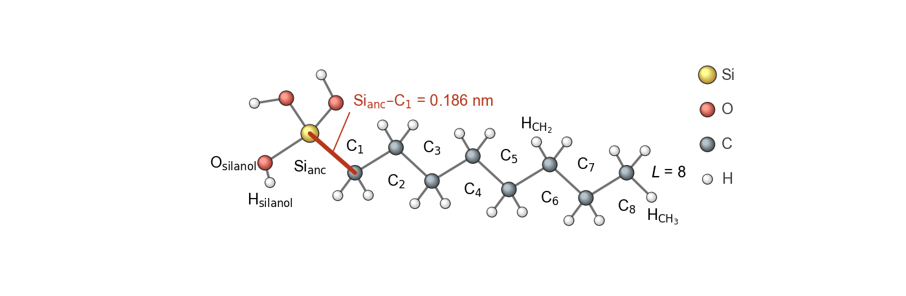

# Si-C force field validation


The force field of alkylsilane monolayers on silica has terms at the bond between the silicon of the head group,
Si<sub>anc</sub>, and the first carbon of the alkyl chain, C<sub>1</sub>, which CHARMM does not have. This repository
compares these terms with quantum chemistry: relaxed scans of the model molecule octylsilanetriol,
Si(OH)<sub>3</sub>–C<sub>8</sub>H<sub>17</sub>, at the HF/6-31G\* level (ORCA), against the force-field energy of
the same molecule at the same structures (MM, GROMACS). Each coordinate at the Si–C bond is compared with the same
coordinate in the alkyl chain, whose CHARMM terms are the reference.



## What is compared

| At the Si–C bond | Reference in the alkyl chain | Relaxed scans |
|--|--|--|
| Si<sub>anc</sub>–C<sub>1</sub> bond | C<sub>4</sub>–C<sub>5</sub> bond | 50 points each, 0.180–0.194 nm and 0.145–0.159 nm |
| Si<sub>anc</sub>–C<sub>1</sub>–C<sub>2</sub> angle | C<sub>3</sub>–C<sub>4</sub>–C<sub>5</sub> angle | 50 points each, 100–130° and 98–128° |
| Si<sub>anc</sub>–C<sub>1</sub>–C<sub>2</sub>–C<sub>3</sub> dihedral | C<sub>3</sub>–C<sub>4</sub>–C<sub>5</sub>–C<sub>6</sub> dihedral | 37 points each, −180 to 180° |
| O–Si<sub>anc</sub>–C<sub>1</sub> angle | | 50 points, 97–127° |
| O–Si<sub>anc</sub>–C<sub>1</sub>–C<sub>2</sub> dihedral | | 37 points, −185 to 175° |

The notebook also compares the relaxed molecule with the minimum of the force-field energy, fits the force constants
of the bond and angle scans, and calibrates the ORCA force constants on the CHARMM C–C bond. Its section Force field
lists all parameters of the force field.

## Files

- `Si-C_force_field_validation.ipynb`: the comparison, from the ORCA and GROMACS files to the figures and tables
- `ORCA_results/relaxation/`: relaxation and vibrational frequencies of the molecule
- `ORCA_results/scans/`: the eight relaxed scans
- `force_field_energies/`: GROMACS energies of the scan structures, and the minimum of the force-field energy of the
  molecule
- `figures/`: every plot of the notebook as a PDF file, written when the notebook runs
- `doc/`: the schematic drawings of the notebook (PDF and PNG), made with `make_drawings.py` and `molecule_drawing.py`
- `ForceField/`: the force-field files: CHARMM36 (GROMACS port of July 2022), the INTERFACE force field of silica, the
  terms at the Si–C bond and at the bridge to the silica, and CHARMM TIP3P water
- `GROMACS_force_field/`: the same force field as one GROMACS force-field folder, `alkylsilane_silica.ff`
- `images/`: the box at the top of this file

Each data folder has its own README.txt.

## The force field for GROMACS

`GROMACS_force_field/alkylsilane_silica.ff` has the 14 atom types of alkylsilane monolayers on silica in water and
every parameter between them, with the values of the files in `ForceField`:

| Atom types | Atoms | Force field |
|--|--|--|
| CG321, CG331, HGA2, HGA3 | C and H of the CH<sub>2</sub> and CH<sub>3</sub> groups of the chain | CHARMM36 (CGenFF types) |
| SI, OSIH, HSIO | Si<sub>anc</sub> and its OH groups | CHARMM36 |
| ISC4, IOC23, IOC24, IOC25, IHOY | Si of the silica, its oxygens (Si–O–Si, silanol, bridge to Si<sub>anc</sub>) and silanol H | INTERFACE |
| OT, HT | water | CHARMM TIP3P |

Include it at the top of a topology:

```
#include "alkylsilane_silica.ff/forcefield.itp"
#include "monolayer.itp"
#include "alkylsilane_silica.ff/tip3p.itp"
```

Here `monolayer.itp` is the molecule topology of the silica slab with its chains: the atoms with their types and
charges, the bonds, 1–4 pairs, angles and dihedrals. For a monolayer in water, the files in `ForceField` and
`alkylsilane_silica.ff` give the same energy terms in GROMACS. `GROMACS_force_field/README.txt` has the details.

## Running the notebook

Open `Si-C_force_field_validation.ipynb` in Jupyter or VS Code and run all cells. The first cell installs the Python
packages it needs (numpy, pandas, matplotlib, ase, nglview 3.0.8 and ipywidgets); restart the kernel after it. The
structure viewers (nglview) show up only when the notebook runs.

## Redoing the calculations

- ORCA: `orca <name>.inp > <name>.out` in `ORCA_results/relaxation` and in each folder of `ORCA_results/scans`
- GROMACS 2025 (`gmx` in the PATH): `python3 make_frames.py` and then `bash run_energies.sh` in
  `force_field_energies`
- The drawings: `python3 make_drawings.py`
- The force-field folder: `python3 make_force_field.py` in `GROMACS_force_field`

## References

- ORCA: F. Neese, *WIREs Comput. Mol. Sci.* **12**, e1606 (2022).
- GROMACS: M. J. Abraham et al., *SoftwareX* **1–2**, 19–25 (2015).
- CHARMM: B. R. Brooks et al., *J. Comput. Chem.* **30**, 1545–1614 (2009).
- CGenFF: K. Vanommeslaeghe et al., *J. Comput. Chem.* **31**, 671–690 (2010).
- CHARMM terms of silica and silanols: P. E. M. Lopes et al., *J. Phys. Chem. B* **110**, 2782–2792 (2006).
- INTERFACE force field of silica: F. S. Emami et al., *Chem. Mater.* **26**, 2647–2658 (2014).
- TIP3P water: W. L. Jorgensen et al., *J. Chem. Phys.* **79**, 926–935 (1983).
- nglview: H. Nguyen, D. A. Case, A. S. Rose, *Bioinformatics* **34**, 1241–1242 (2018).
- ASE: A. H. Larsen et al., *J. Phys.: Condens. Matter* **29**, 273002 (2017).

The notebook has the full list.

## Author

Kourosh Hasheminejad
